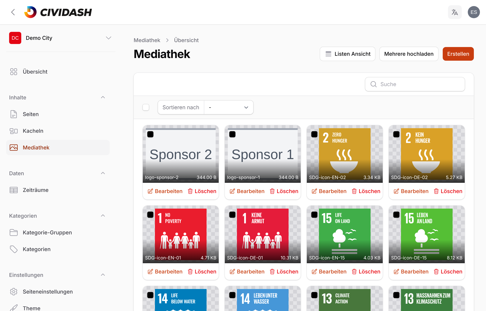
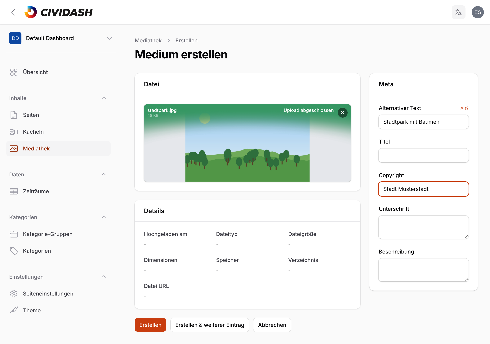
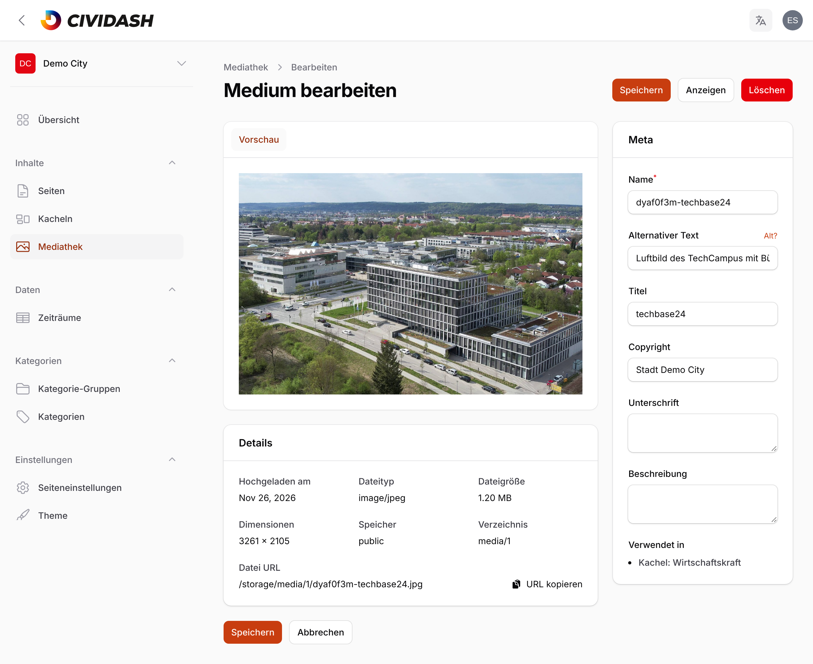
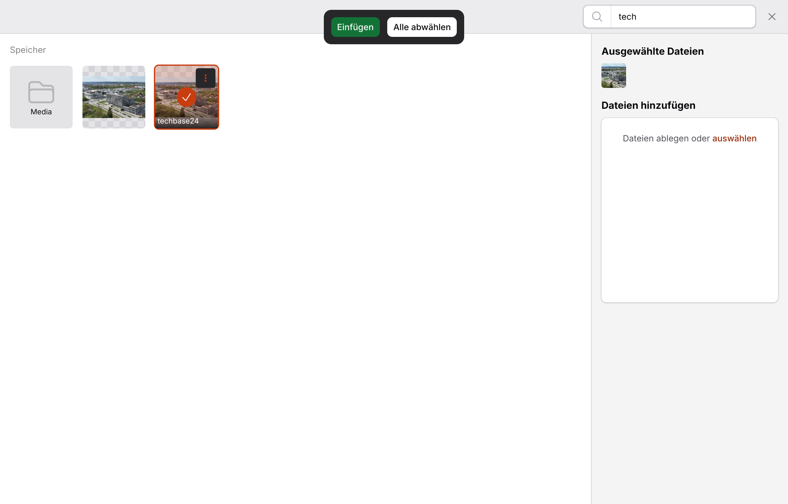
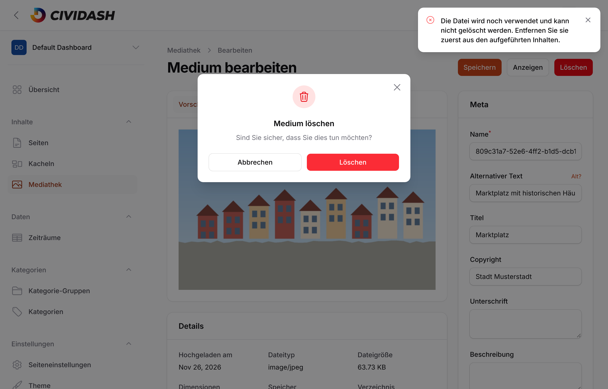
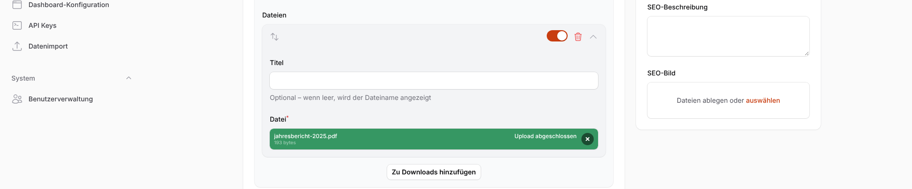
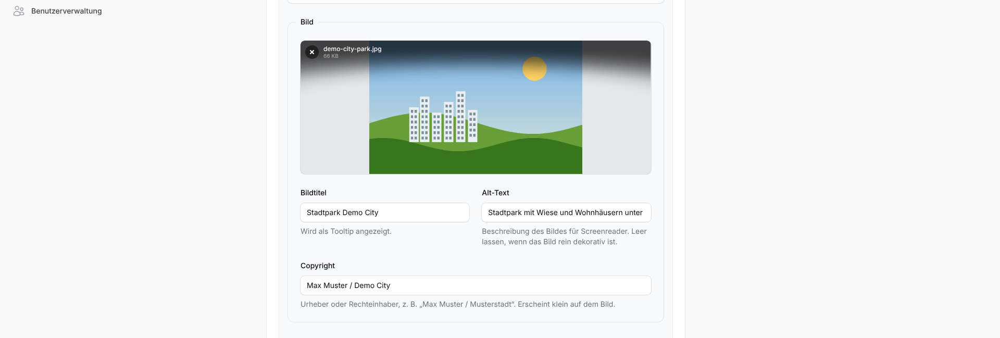
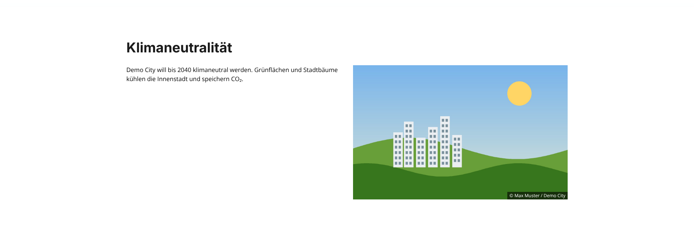
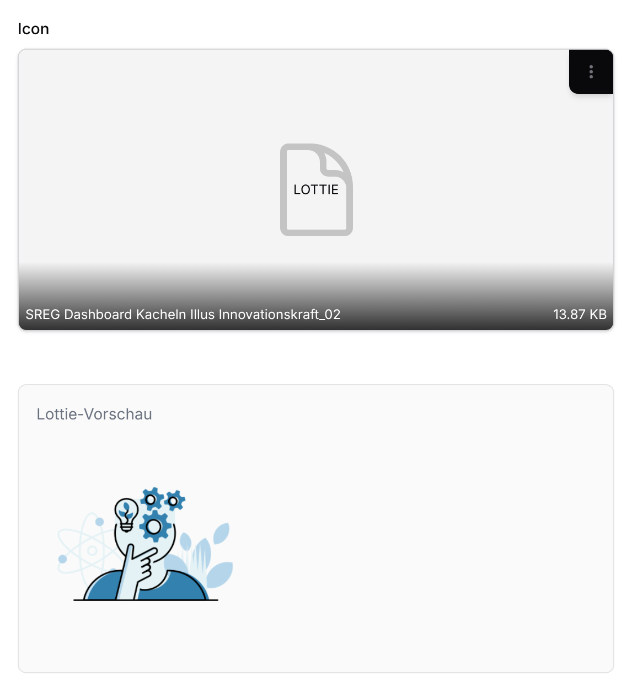

# 5. Bilder und Dateien

Medienhandling im Adminbereich.

## 5.1 Mediathek

Die Mediathek ist die zentrale Ablage für Bilder und Dateien eines Dashboards. Sie liegt in der Navigation unter **Inhalte → Mediathek**. Jedes Dashboard hat eine eigene Mediathek; Dateien anderer Dashboards sind dort nicht sichtbar.

<!-- Screenshot: Mediathek, Rasteransicht mit Vorschaubildern, Suche und den Schaltflächen „Mehrere hochladen“ und „Erstellen“ -->

### Datei hochladen

1. **Inhalte → Mediathek** öffnen und auf **Erstellen** klicken. Mehrere Dateien auf einmal lassen sich über **Mehrere hochladen** übernehmen.
2. Datei in die Fläche ziehen oder über **auswählen** wählen.
3. Warten, bis „Upload abgeschlossen“ erscheint.
4. Optional **Alternativer Text** und **Titel** je Sprache (Reiter **DE** und **EN**) sowie **Copyright** ausfüllen.
5. Auf **Erstellen** klicken.

<!-- Screenshot: Seite „Medium erstellen“ mit hochgeladener Datei und ausgefüllten Feldern Alternativer Text und Copyright -->

Neue Dateien landen automatisch im Ordner des Dashboards; unter **Details → Dashboard** steht, zu welchem Dashboard die Datei gehört. Ordner lassen sich weder wählen noch anlegen.

Alternativer Text und Titel gibt es je Sprache. Bleibt eine Sprache leer, gilt dort der deutsche Text; das Feld zeigt dann einen Hinweis. Copyright, Unterschrift und Beschreibung gelten für alle Sprachen. Inhaltsbilder übernehmen diese Angaben überall dort, wo die Begleitfelder im Block leer bleiben (siehe [5.3](#53-alt-texte-und-barrierefreiheit)).

Die Mediathek nimmt Bilder, Lottie-Animationen, PDF-, Word-, Excel- und ZIP-Dateien bis 25 MB an. Das Feld, in dem die Datei später verwendet wird, kann ein kleineres Limit haben (siehe [5.2](#52-unterstützte-formate-und-größen)).

<!-- Screenshot: Mediathek, Seite „Medium bearbeiten“ mit Vorschau, Details, Meta-Feldern und „Verwendet in“ -->

### Datei in einem Feld verwenden

Bild- und Dateifelder in Seiten, Kacheln, Theme und Footer zeigen die Schaltfläche **Aus Mediathek wählen**.

1. Auf **Aus Mediathek wählen** klicken. Ein Auswahlfenster mit den Dateien der Mediathek öffnet sich.
2. Datei über die Suche finden und anklicken.
3. Auf **Einfügen** klicken.

<!-- Screenshot: Auswahlfenster der Mediathek aus einem Text-&-Bild-Block, eine Datei ausgewählt -->

Eine neue Datei lässt sich auch direkt im Auswahlfenster unter **Dateien hinzufügen** hochladen. Sie landet dabei in der Mediathek und steht danach auch anderen Feldern zur Verfügung.

Dieselbe Datei kann in beliebig vielen Feldern verwendet werden. Eine Datei lässt sich nicht austauschen: Für eine neue Fassung die neue Datei hochladen und in den Feldern auswählen.

### Verwendung prüfen und Dateien löschen

Die Seite **Medium bearbeiten** listet unter **Verwendet in** alle Seiten, Kacheln und Einstellungen, die die Datei nutzen, jeweils mit Link.

Eine Datei, die noch verwendet wird, lässt sich nicht löschen. Der Adminbereich meldet dann, dass die Datei noch verwendet wird. Zuerst die Datei an allen aufgeführten Stellen entfernen oder ersetzen, danach löschen.

<!-- Screenshot: Hinweis „Die Datei wird noch verwendet …“ nach dem Löschversuch -->

### Bestehende Dateien

Dateien, die vor Einführung der Mediathek hochgeladen wurden, übernimmt CiviDash bei der Aktualisierung als Kopie in die Mediathek des jeweiligen Dashboards. Die ursprüngliche Datei bleibt erhalten, die Inhalte ändern sich nicht. Ein Feld, dessen Datei nicht mehr vorhanden ist, zeigt weiterhin den gespeicherten Pfad und behält ihn beim Speichern.

> **Hinweis:** Ein Zuschneide-Werkzeug gibt es nur für das Profilbild (siehe [Kapitel 1.4, Profil bearbeiten](01-erste-schritte.md)). Es wird automatisch quadratisch auf 256×256 Pixel zugeschnitten. Dateien der Mediathek bleiben in Originalgröße gespeichert; das Frontend lädt bei großen Bildern automatisch eine verkleinerte Fassung.

> **Hinweis:** Schriftart-Dateien, Theme-Import, Datenimport und Profilbild nutzen weiterhin ein eigenes Upload-Feld und erscheinen nicht in der Mediathek. Das gilt auch für die Bild-Blöcke unter „Inhalte verwalten“.

## 5.2 Unterstützte Formate und Größen

Welche Dateiformate und Größenbeschränkungen gelten, hängt vom jeweiligen Feld ab. Für Felder mit **Aus Mediathek wählen** gilt das Limit beim Hochladen im Auswahlfenster:

| Bereich | Erlaubte Formate | Größenlimit |
|---------|-------------------|-------------|
| Profilbild (Avatar) | Bildformate | 2 MB |
| Kategorie-Icon | PNG, JPEG, GIF, WebP, SVG | 1 MB |
| Kachel-Icon | Bildformate, JSON (Lottie), .lottie (dotLottie) | 2 MB |
| Kennzahl-Icon | Bildformate | 2 MB |
| Inhaltsbilder in Seiten-/Kachel-Blöcken (Intro-Text, Text & Bild, Slider) | Bildformate | 5 MB |
| Bild-Blöcke in „Inhalte verwalten" | Bildformate | 5 MB |
| SEO-Bild (Seiten und Kacheln) | Bildformate | 5 MB |
| Downloads (Download-Block) | PDF, Word, Excel, ZIP | 25 MB |
| Logo | Bildformate | 2 MB |
| Favicon | ICO, PNG, SVG | 512 KB |
| Social-Media-Icon (Footer) | Bildformate | 1 MB |
| Sponsoren-Logo (Footer) | Bildformate | 5 MB |
| Eigene Schriftart-Datei | WOFF2, WOFF, TTF, OTF | 5 MB |
| Datenimport-Datei | JSON, Text | 20 MB |

<!-- Screenshot: Datei-Upload im Download-Block -->

> **Hinweis:** Große Bilddateien vor dem Hochladen sinnvoll komprimieren, um Ladezeiten im Frontend gering zu halten.

## 5.3 Alt-Texte und Barrierefreiheit

Jedes Inhaltsbild in den Blöcken **Intro-Text** (Haupt- und zweites Bild), **Text & Bild** und **Slider** hat drei Begleitfelder. Sie stehen zusammen mit dem Bildfeld in einem eigenen Rahmen.

Ein leeres Begleitfeld übernimmt den Wert aus der Mediathek (**Alternativer Text**, **Titel**, **Copyright** der Datei), bei Alt-Text und Titel in der Sprache der Seite, ersatzweise den deutschen. Ein im Block ausgefülltes Feld hat Vorrang. Das gilt für jeden Block und jede Sprache einzeln.

Alt-Text und Titel lassen sich in der Mediathek je Sprache pflegen, dann gelten sie für jede Verwendung der Datei. Das Begleitfeld im Block ist für Fälle gedacht, in denen ein Bild an einer Stelle anders beschrieben werden soll. Das Copyright gilt für alle Sprachen und genügt einmal in der Mediathek.

<!-- Screenshot: Text-&-Bild-Block mit hochgeladenem Bild und ausgefüllten Feldern Bildtitel, Alt-Text und Copyright -->

| Feld | Zweck | Wirkung im Frontend |
|------|-------|---------------------|
| **Bildtitel** | Kurzer Titel des Bildes | Erscheint als Tooltip beim Überfahren mit der Maus |
| **Alt-Text** | Beschreibung des Bildinhalts für Screenreader und Suchmaschinen | Nicht sichtbar, wird von Screenreadern vorgelesen |
| **Copyright** | Urheber oder Rechteinhaber, z. B. „Max Muster / Musterstadt“ | Erscheint als kleiner Hinweis unten rechts auf dem Bild, mit vorangestelltem „©“ |

- Alt-Text knapp halten und beschreiben, was auf dem Bild zu sehen ist, nicht „Bild von …“.
- Alt-Text leer lassen, wenn das Bild rein dekorativ ist, im Block und in der Mediathek. Screenreader überspringen es dann.
- Das Zeichen „©“ muss nicht eingegeben werden, es wird automatisch ergänzt.
- Die drei Begleitfelder im Block sind pro Sprache getrennt, wie die übrigen Blockinhalte. Ein leeres Feld zeigt den Wert aus der Mediathek in derselben Sprache, ersatzweise den deutschen.

**Wirkung im Frontend:** Der Copyright-Hinweis liegt als kleine Einblendung mit dunklem, halbtransparentem Hintergrund unten rechts auf dem Bild. Ist das Feld leer, erscheint keine Einblendung.

<!-- Screenshot: Frontend, Text-&-Bild-Block auf der Hintergrundseite einer Kachel mit Copyright-Hinweis unten rechts auf dem Bild -->

> **Hinweis:** Logos, Favicon, Kachel- und Kategorie-Icons sowie Social-Media-Icons sind Gestaltungselemente und haben keine eigenen Bild-Metadaten.

## 5.4 Sonderformate: Lottie-Animationen, SVG-Icons

Das Icon-Feld einer Kachel (siehe [Kapitel 3.2, Neue Kachel anlegen](03-kacheln-verwalten.md)) akzeptiert neben Bildformaten auch Lottie-Animationen: `.json`-Dateien im Bodymovin/Lottie-Format sowie `.lottie`-Dateien (dotLottie-Container). Nach dem Speichern einer Kachel mit einer solchen Datei zeigt das Formular eine **Lottie-Vorschau** mit abspielender Animation:

<!-- Screenshot: Icon-Feld einer Kachel mit einer Lottie-Datei aus der Mediathek und Lottie-Vorschau -->

> **Hinweis:** Die Lottie-Vorschau aktualisiert sich nicht live während des Hochladens — sie erscheint erst nach dem Speichern der Kachel und einem erneuten Laden der Seite. Wird keine Lottie-Datei erkannt (Dateiendung weder `.json` noch `.lottie`), zeigt das Formular stattdessen den Hinweis „Keine Lottie-Animation".

SVG-Icons lassen sich zusätzlich bei Kategorien hochladen (siehe [Kapitel 4.2, Kategorien anlegen und bearbeiten](04-kategorien.md)) — dort ist SVG neben PNG, JPEG, GIF und WebP eines von mehreren erlaubten Formaten für das Kategorie-Icon.
