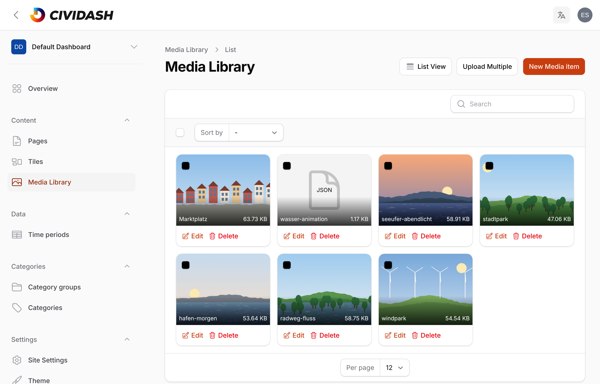
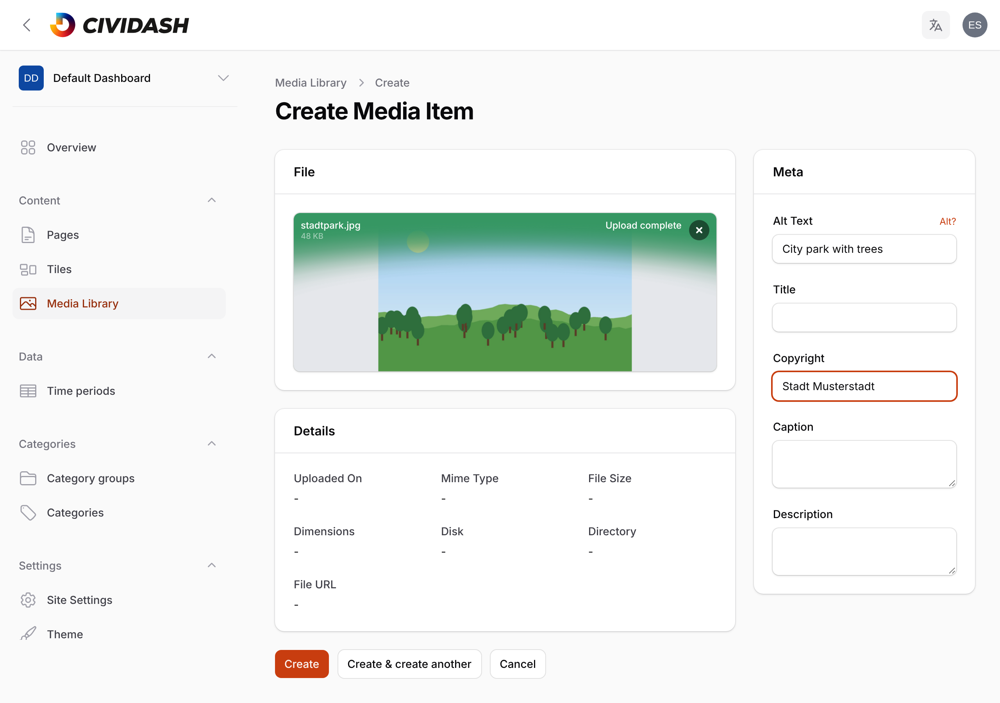
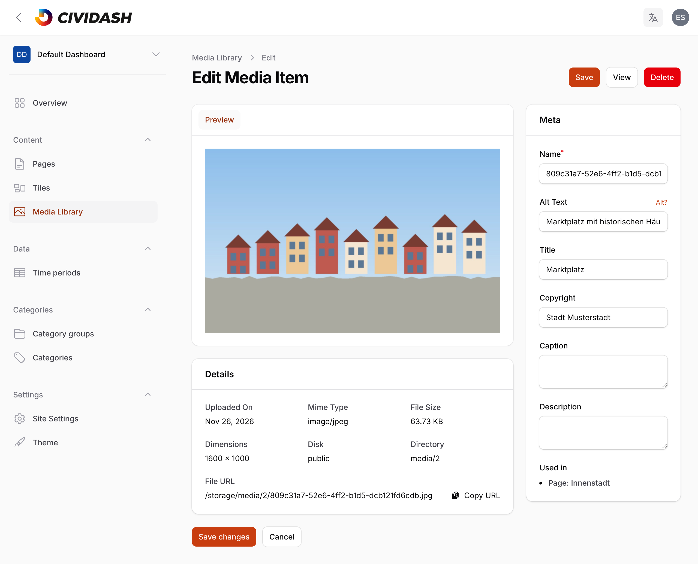
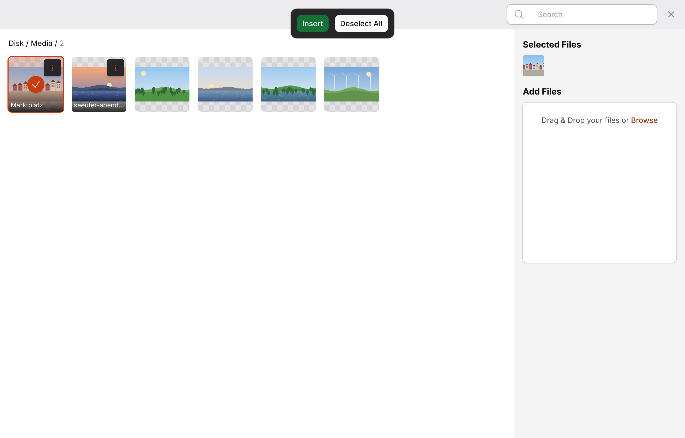
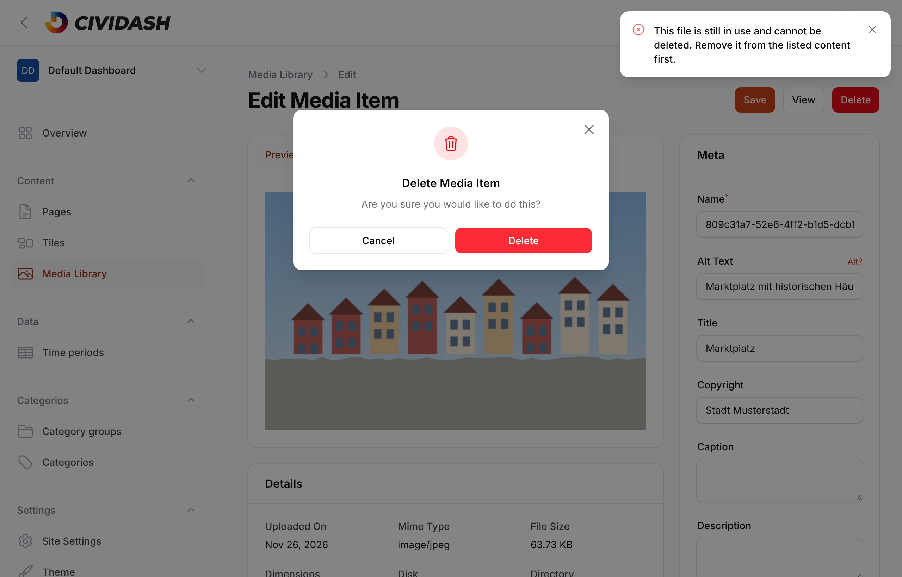
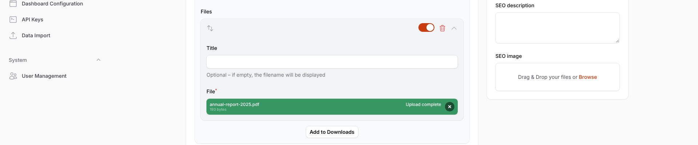
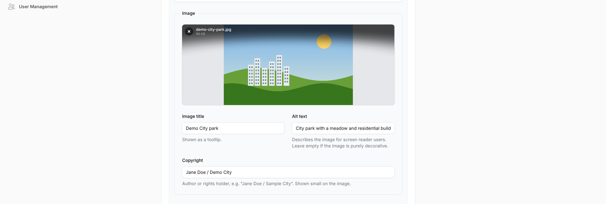
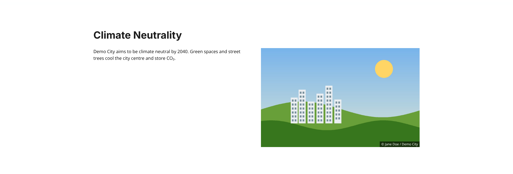
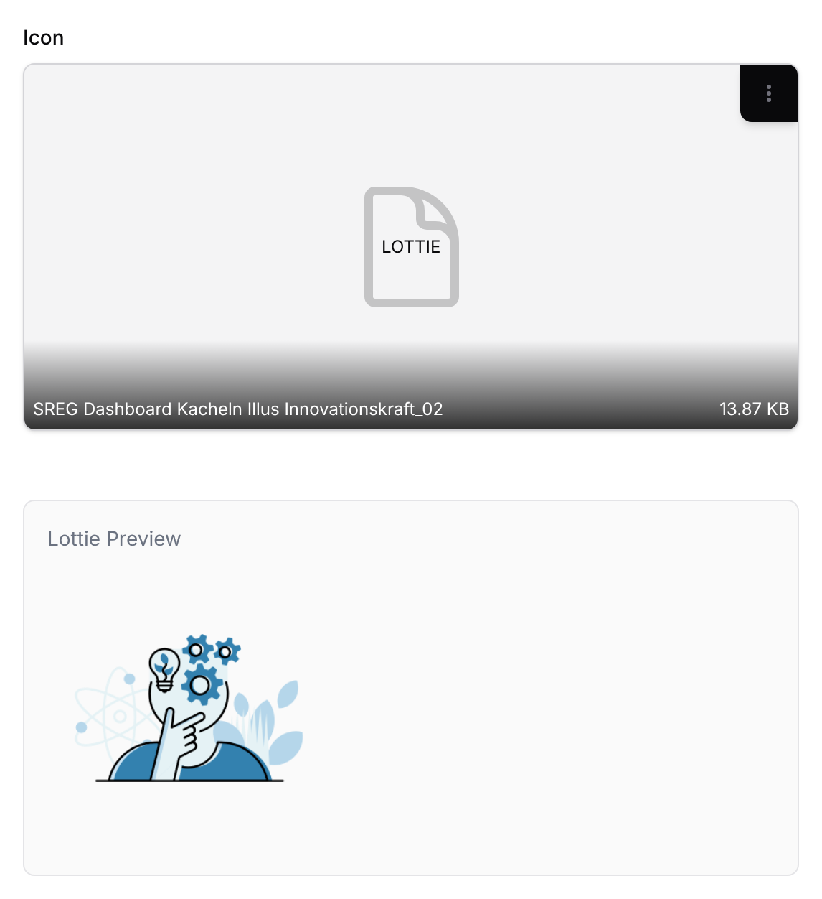

# 5. Images and Files

Media handling in the admin panel.

## 5.1 Media Library

The media library is the central store for a dashboard's images and files. It is in the navigation under **Content → Media Library**. Each dashboard has its own media library; files of other dashboards are not visible there.

<!-- Screenshot: Media library grid with thumbnails, search and the "Upload Multiple" and "New Media item" buttons -->

### Upload a File

1. Open **Content → Media Library** and click **New Media item**. Several files at once can be added via **Upload Multiple**.
2. Drop the file onto the area or pick it via **Browse**.
3. Wait until "Upload complete" appears.
4. Optionally fill in **Alt Text**, **Title** and **Copyright**.
5. Click **Create**.

<!-- Screenshot: "Create Media Item" page with an uploaded file and filled Alt Text and Copyright fields -->

New files go to the dashboard's folder automatically (shown under **Details → Directory**, for example `media/2`). Folders can't be chosen or created.

These details apply to all languages. Content images use them wherever the companion fields in the block stay empty (see [5.3](#53-alt-text-and-accessibility)).

The media library takes images, Lottie animations, PDF, Word, Excel and ZIP files up to 25 MB. The field that later uses the file can have a smaller limit (see [5.2](#52-supported-formats-and-sizes)).

<!-- Screenshot: Media library, "Edit Media Item" page with preview, details, meta fields and "Used in" -->

### Use a File in a Field

Image and file fields in pages, tiles, theme and footer show the button **Choose from media library**.

1. Click **Choose from media library**. A picker with the files of the media library opens.
2. Find the file via search and click it.
3. Click **Insert**.

<!-- Screenshot: Media library picker opened from a Text & Image block, one file selected -->

A new file can also be uploaded directly in the picker under **Add Files**. It is stored in the media library and is then available to other fields too.

The same file can be used in any number of fields. A file cannot be swapped: for a new version, upload the new file and pick it in the fields.

### Check Usage and Delete Files

The **Edit Media Item** page lists under **Used in** all pages, tiles and settings that use the file, each with a link.

A file that is still in use cannot be deleted. The admin area then reports that the file is still in use. First remove or replace the file in every listed place, then delete it.

<!-- Screenshot: Notice "This file is still in use …" after a delete attempt -->

### Existing Files

Files uploaded before the media library existed are copied into the media library of their dashboard during the update. The original file stays in place and content does not change. A field whose file no longer exists keeps showing the stored path and keeps it when saved.

> **Note:** A cropping tool exists only for the avatar (see [Chapter 1.4, Edit Profile](01-getting-started.md)). It is cropped to a square and resized to 256×256 pixels automatically. Files in the media library are stored at their original size; for large images the frontend loads a smaller version automatically.

> **Note:** Font files, theme import, data import and avatar keep their own upload field and do not appear in the media library. The same applies to the image blocks under "Manage Content".

## 5.2 Supported Formats and Sizes

Which file formats and size limits apply depends on the specific field. For fields with **Choose from media library**, the limit applies when uploading in the picker:

| Area | Allowed formats | Size limit |
|------|------------------|------------|
| Avatar | Image formats | 2 MB |
| Category icon | PNG, JPEG, GIF, WebP, SVG | 1 MB |
| Tile icon | Image formats, JSON (Lottie), .lottie (dotLottie) | 2 MB |
| Metric icon | Image formats | 2 MB |
| Content images in page/tile blocks (Intro Text, Text & Image, Slider) | Image formats | 5 MB |
| Image blocks in "Manage Content" | Image formats | 5 MB |
| SEO image (pages and tiles) | Image formats | 5 MB |
| Downloads (Download block) | PDF, Word, Excel, ZIP | 25 MB |
| Logo | Image formats | 2 MB |
| Favicon | ICO, PNG, SVG | 512 KB |
| Social media icon (footer) | Image formats | 1 MB |
| Sponsor logo (footer) | Image formats | 5 MB |
| Custom font file | WOFF2, WOFF, TTF, OTF | 5 MB |
| Data import file | JSON, Text | 20 MB |

<!-- Screenshot: File upload in the Download block -->

> **Note:** Compress large image files before uploading, to keep frontend load times low.

## 5.3 Alt Text and Accessibility

Every content image in the **Intro Text** (main and second image), **Text & Image** and **Slider** blocks has three companion fields. They sit in their own frame together with the image field.

An empty companion field takes the value from the media library (the file's **Alt Text**, **Title** and **Copyright**). A field filled in the block takes precedence. This applies to each block and each language separately.

The media library holds one set of these details for all languages. Language-specific text, such as an English alt text, therefore belongs in the companion field in the block, in that language. Language-neutral details such as the copyright only need to be maintained once in the media library.

<!-- Screenshot: Text & Image block with an uploaded image and filled image title, alt text and copyright fields -->

| Field | Purpose | Effect in the frontend |
|-------|---------|------------------------|
| **Image title** | Short title of the image | Shown as a tooltip on mouse hover |
| **Alt text** | Description of the image content for screen readers and search engines | Not visible, read out by screen readers |
| **Copyright** | Author or rights holder, e.g. “Jane Doe / Sample City” | Shown as a small notice in the bottom right corner of the image, prefixed with “©” |

- Keep alt text short and describe what the image shows, not “image of …”.
- Leave alt text empty if the image is purely decorative, both in the block and in the media library. Screen readers then skip it.
- There is no need to type “©”, it is added automatically.
- The three companion fields in the block are separate per language, like the rest of the block content. An empty field shows the same media library value in every language.

**Effect on the frontend:** The copyright notice sits as a small overlay with a dark, semi-transparent background in the bottom right corner of the image. If the field is empty, no overlay is shown.

<!-- Screenshot: Frontend, Text & Image block on a tile background page with the copyright notice in the bottom right corner of the image -->

> **Note:** Logos, favicon, tile and category icons and social media icons are design elements and have no image metadata of their own.

## 5.4 Special Formats: Lottie Animations, SVG Icons

The icon field of a tile (see [Chapter 3.2, Create a New Tile](03-managing-tiles.md)) accepts Lottie animations in addition to image formats: `.json` files in Bodymovin/Lottie format, and `.lottie` files (dotLottie container). After saving a tile with such a file, the form shows a **Lottie preview** with the animation playing:

<!-- Screenshot: tile icon field with an uploaded Lottie file and the Lottie preview -->

> **Note:** The Lottie preview does not update live during upload — it only appears after saving the tile and reloading the page. If no Lottie file is detected (file extension is neither `.json` nor `.lottie`), the form shows "No Lottie animation" instead.

SVG icons can also be uploaded for categories (see [Chapter 4.2, Create and Edit Categories](04-categories.md)) — there, SVG is one of several allowed formats for the category icon, alongside PNG, JPEG, GIF, and WebP.
